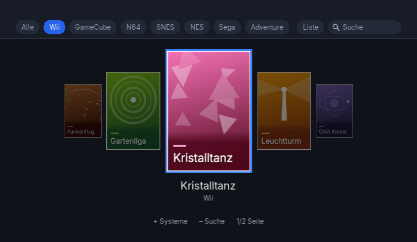
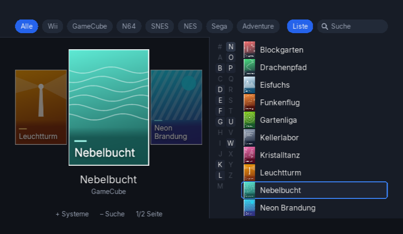
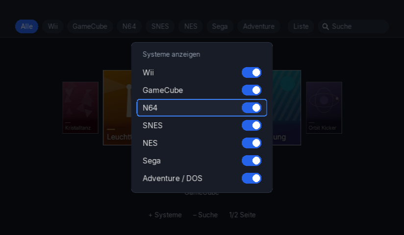
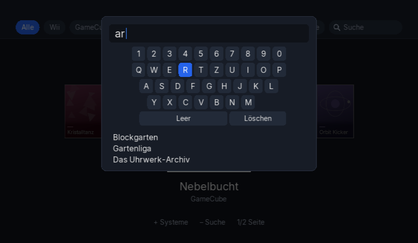
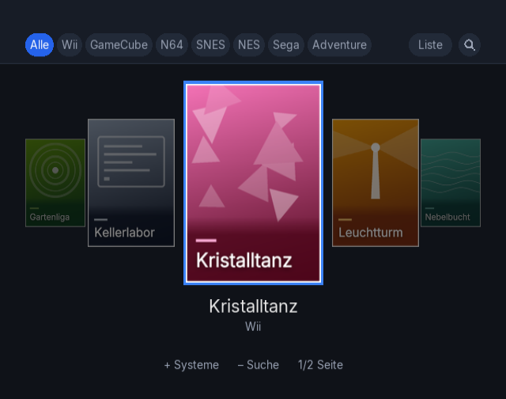

# Wii Launcher

Startbildschirm (Homebrew) für die Nintendo Wii. Er listet die Spiele von der USB-Platte (Wii, GameCube und Emulator-Titel) als Cover-Fächer, lässt sich mit Wiimote-Zeiger oder Steuerkreuz bedienen und startet das Spiel über das passende Programm. Gedacht für alle, die eine Wii mit Homebrew Channel als Spielekonsole am Fernseher nutzen und nicht für jedes System ein eigenes Programm anwählen wollen.

*English:* A homebrew start screen for the Nintendo Wii. It shows the games on a USB drive (Wii, GameCube, emulator titles) as a cover fan and hands the selected game over to USB Loader GX, Nintendont/Not64 or the matching emulator. The documentation is in German.



## Funktionen

- Tabs je System: Alle, Wii, GameCube, N64, SNES, NES, Sega (Mega Drive, Master System, SG-1000) und Adventure (ScummVM, DOSBox). Welche Systeme aktiv sind, steht in `sd:/launcher/settings.txt`, die Einblendung „Systeme anzeigen" schaltet sie um.
- Cover-Fächer über alle Spiele des aktiven Tabs, alphabetisch sortiert.
- Liste als Einblendung mit A-Z-Spalte zum schnellen Springen.
- Suche mit Live-Treffern.
- Bedienung mit Wiimote-Zeiger oder Steuerkreuz.
- Start über USB Loader GX (Wii, GameCube), Not64 (N64), Snes9x GX, FCEUGX, Genesis Plus GX, ScummVM und DOSBox. Für DOSBox-Spiele wird die `dosbox.conf` aus einer Vorlage erzeugt.
- Zuletzt gespielt: Beim Start und nach jedem Spielstart steht der Fächer auf dem zuletzt gestarteten Spiel.
- 16:9 und 4:3, die Schrift wird bei 16:9 im physischen Pixelraster gezeichnet.
- Optionaler Autostart über Priiloader mit einem kleinen Forwarder (`forwarder.dol`).

## Screenshots

Liste mit A-Z-Spalte:



Einblendung „Systeme anzeigen":



Suche:



Darstellung bei 4:3:



Die Bilder stammen aus Dolphin mit der Testkarte unter `tools/dolphin-sd/`. Titel und Cover darin sind erfunden.

## Voraussetzungen

- Wii mit installiertem Homebrew Channel.
- SD-Karte für den Launcher und die Startprogramme, USB-Platte für Spiele und ROMs.
- Die Programme, die der Launcher aufruft, auf der SD-Karte (siehe unten). Nur die Programme der Systeme, die man nutzt, sind nötig. `tools/deploy-sd.sh` warnt, wenn welche fehlen.

## Aufbau von SD-Karte und USB-Platte

Beide Datenträger FAT32. Der Launcher sucht die Pfade genau so, Groß- und Kleinschreibung der Ordner wie angegeben.

SD-Karte:

```
sd:/
├── apps/
│   ├── launcher/            boot.dol, meta.xml, icon.png (dieser Launcher)
│   ├── usbloader_gx/        boot.dol   Wii und GameCube
│   ├── Nintendont/          boot.dol   GameCube (startet USB Loader GX, Pfad dort einstellbar)
│   ├── not64/               boot.dol   N64
│   ├── snes9xgx/            boot.dol   SNES
│   ├── fceugx/              boot.dol   NES
│   ├── genplus-gx/          boot.dol   Mega Drive, Master System, SG-1000
│   ├── scummvm/             boot.elf   Adventure (ScummVM)
│   └── dosbox-wii/          boot.dol   Adventure (DOSBox), dosbox.conf schreibt der Launcher
├── config/images/2D/        <ID6>.png  Wii- und GameCube-Cover (von USB Loader GX geladen)
├── launcher/
│   ├── settings.txt         Einstellungen (siehe unten)
│   ├── recent.txt           zuletzt gespielt (schreibt der Launcher)
│   ├── launcher.log         Protokoll je Start (schreibt der Launcher)
│   ├── dosbox.conf.tpl      Vorlage für dosbox.conf
│   └── covers/
│       ├── n64/  snes/  nes/  sega/    <ROM-Name ohne Endung>.png
│       └── dos/             <Spielordner>.png
├── not64/settings.cfg       schreibt der Launcher vor jedem N64-Start (ROM-Pfad)
└── forwarder.dol            nur für den Priiloader-Autostart
```

USB-Platte:

```
usb:/
├── wbfs/
│   └── <Titel> [<ID6>]/<ID6>.wbfs     Wii (auch direkt als wbfs/<Titel> [<ID6>].wbfs)
├── games/
│   └── <Titel> [<ID6>]/game.iso       GameCube
├── not64/roms/              .z64 .n64 .v64
├── snes9xgx/roms/           .sfc .smc .zip
├── fceugx/roms/             .nes .unf .zip
├── genplus/roms/
│   ├── md/                  .md .gen .smd .bin .zip
│   ├── sms/                 .sms .zip
│   └── sg/                  .sg .zip
├── scummvm/<Spiel>/         Spieldateien, ScummVM erkennt das Spiel selbst
└── dosbox/<Spiel>/          Spieldateien, optional autoexec.txt mit dem Startbefehl
```

Der Titel im Launcher entsteht aus dem Datei- bzw. Ordnernamen ohne Klammerzusätze wie `(Europe)` oder `[RMCP01]`. Ordner, die nicht existieren, werden übersprungen.

`sd:/launcher/settings.txt` hat zwei Schlüssel:

```
systems=wii,gc,n64,snes,nes,sega,dos   # sichtbare Tabs, lässt sich auch im Launcher unter "Systeme" umschalten
extra_root=                            # optional: zusätzlicher Wurzelordner mit derselben Struktur wie usb:/
```

`tools/dolphin-sd/` im Repo ist ein kleines Beispiel dieser Struktur (mit `extra_root=sd:/launcher/mock` als Ersatz für die USB-Platte).

## Installation aus dem Release-Paket

Das Paket `wii-launcher-<version>.zip` wird direkt in das Wurzelverzeichnis der SD-Karte entpackt. Es enthält:

- `apps/launcher/boot.dol`, `meta.xml`, `icon.png`: der Launcher für den Homebrew Channel
- `forwarder.dol`: Starter für den Priiloader-Autostart
- `wii-launcher/LIESMICH.txt`, `LICENSE`, `font-LICENSE.txt`: Kurzanleitung und Lizenztexte

Danach die SD-Karte in die Wii stecken und im Homebrew Channel „Launcher" starten. Für den Start direkt nach dem Einschalten Priiloader einrichten, die Schritte stehen in `docs/priiloader.md`.

Das Paket selbst erzeugt `tools/make-release.sh [--skip-build]` nach `dist/wii-launcher-<version>.zip` (Version aus `launcher/meta.xml`). Ohne `--skip-build` ruft das Skript vorher `make` auf, mit `--skip-build` verwendet es die vorhandenen `launcher.dol` und `forwarder.dol`.

## Bedienung

Das Hauptbild zeigt oben die Leiste (Tabs je System, Pille „Liste", Suche) und darunter einen Fächer aus Covern über alle Spiele des aktiven Tabs, alphabetisch. Der Launcher startet im Tab „Wii", „Alle" liegt links davon. Beim Start und nach jedem Spielstart steht der Fächer auf dem zuletzt gespielten Spiel.

- Fächer: Steuerkreuz links/rechts blättert um ein Spiel (gehalten immer schneller), 1/2 springen zehn Spiele zurück/vor, A startet das Mittelcover. Ein Klick auf ein Seitencover springt dorthin, ein Klick auf die Mitte startet.
- Liste: Steuerkreuz runter oder Klick auf „Liste" blendet sie von rechts ein (A-Z-Spalte und zehn Zeilen). Das Mittelcover zeigt immer das gewählte Spiel. In der Liste blättern 1/2 seitenweise, A startet; ein Klick wählt eine Zeile, ein zweiter Klick startet sie.
- Liste schließen: B, Klick auf „Liste", Klick daneben oder Steuerkreuz links in der A-Z-Spalte.
- Steuerkreuz hoch führt zu den Tabs, + öffnet „Systeme", - die Suche, Home das Home-Menü.

## Bauen

Voraussetzung ist devkitPro mit devkitPPC, libogc, GRRLIB und libfat (siehe `docs/toolchain.md`). Das Top-Level-Makefile setzt `DEVKITPRO` und `DEVKITPPC` selbst (Standard `/opt/devkitpro`).

```bash
make            # launcher/launcher.dol, forwarder/forwarder.dol und booter
make test       # Host-Tests der Core-Logik (System-C++-Compiler)
make clean
```

Der Code ist zweigeteilt: `launcher/source/core/` enthält plattformfreie C++17-Logik, die auf dem Rechner getestet wird, `launcher/source/wii/` die libogc/GRRLIB-Anbindung.

## Deploy

`tools/deploy-sd.sh` kopiert den Launcher nach `/Volumes/WII/apps/launcher/` (`boot.dol`, `meta.xml`, `icon.png`), den Forwarder nach `/Volumes/WII/forwarder.dol` und legt bei Bedarf `/Volumes/WII/launcher/settings.txt` und `dosbox.conf.tpl` an (vorhandene Dateien bleiben unberührt, `--force-tpl` überschreibt `dosbox.conf.tpl`). Ist die USB-Platte `/Volumes/WII-ROMS` gemountet, entsteht außerdem `dosbox/SimCity 2000/autoexec.txt`. `._*`-Dateien werden entfernt, die SD wird nicht ausgeworfen. Mit `--dry-run` wird nur angezeigt, was passieren würde. Andere Mountpunkte lassen sich über die Umgebungsvariablen `WII_SD` und `WII_USB` setzen. Am Ende warnt das Skript, wenn Startprogramme fehlen, die der Launcher aufruft, bricht deswegen aber nicht ab.

Rückweg aus Spielen: Ohne Priiloader-Autostart landet man nach einem Spiel im Wii-Menü, nicht im HBC (der Launcher löscht den HBC-Stub vor dem Start). Priiloader-Autostart einrichten: `docs/priiloader.md`. Toolchain: `docs/toolchain.md`.

## Wii-Upload

```bash
tools/wiiload.sh <Wii-IP>   # sendet launcher/launcher.dol, HBC muss laufen
```

## Cover

Die Cover der Spiele sind urheberrechtlich geschützt und liegen deshalb nicht im Repo. Der Download erfolgt durch den Nutzer für die eigene Sammlung, eine Weiterverbreitung ist nicht vorgesehen. Woher die Bilder kommen:

- Wii und GameCube: Der Launcher liest die 2D-Cover, die USB Loader GX selbst herunterlädt und unter `sd:/config/images/2D/<ID>.png` ablegt. Dazu in USB Loader GX den Cover-Download ausführen (Quelle dort ist GameTDB).
- Emulator-Systeme und Adventure: `tools/covers-emu.py` (siehe unten), Quelle libretro-thumbnails.
- Eigene Bilder gehen auch: eine PNG-Datei mit passendem Dateinamen am jeweiligen Pfad ablegen (Pfade unten, Größen im Absatz „Cover-Größen").

`tools/covers-emu.py` lädt Boxart-Cover aus den Libretro-Thumbnails für N64, SNES, NES, Sega und Adventure (ScummVM/DOSBox) nach `/Volumes/WII/launcher/covers/<System>/<ROM-Name>.png` (Adventure: `covers/dos/<Spielordner>.png`). Cover werden auf höchstens 320x228 verkleinert (Seitenverhältnis bleibt). Titel werden wie im Launcher normalisiert und per Name bzw. Ähnlichkeit (>= 0,85) zugeordnet.

```bash
python3 -I tools/covers-emu.py --dry-run             # nur Trefferbericht
python3 -I tools/covers-emu.py --system n64 --limit 20
python3 -I tools/covers-emu.py --system dos --refresh --only "Monkey"   # vorhandene Cover neu laden, nur passende Namen
```

Cover-Größen: Wii/GameCube nutzen die 2D-Cover von USB Loader GX (160x224), Emulator-Cover liegen mit erhaltenem Seitenverhältnis bei höchstens 320x228; der Launcher passt alle unverzerrt ein (Vorschau bis Spaltenbreite x 224).

Ohne `GITHUB_TOKEN` gilt das niedrige anonyme API-Limit; bei Bedarf `export GITHUB_TOKEN=$(gh auth token)`. `--refresh` überschreibt vorhandene Cover, `--only "<Teilstring>"` beschränkt auf ROMs bzw. Spielordner mit diesem Namensteil. Bei Adventure-Ordnern (Kurznamen) trifft auch ein zusammenhängender Teil des Libretro-Namens; ScummVM-Ordner suchen zuerst im Repo ScummVM, dann in DOS, dosbox-Ordner nur in DOS.

Ist die USB-Platte nicht gemountet, kann `--dry-run` stattdessen eine Kopie der ROM-Ordner lesen, deren Pfad in der Umgebungsvariable `WII_COVERS_BACKUP` steht (gleiche Unterordner wie auf der Platte). Ohne die Variable bricht das Skript in diesem Fall ab.

Die Cover unter `tools/dolphin-sd/` sind selbst erzeugte Platzhalter (`tools/make-demo-covers.py`) für die Dolphin-Testkarte.

## RVZ nach ISO

`python3 -I tools/rvz2iso.py <in.rvz> <out.iso>` wandelt Dolphin-RVZ-Images von GameCube-Spielen ohne Fremd-Binaries in rohe ISOs um (Python 3.14, Kompression NONE oder zstd, Junk-Daten werden per LFG rekonstruiert).
`--verify-only` dekodiert nur und gibt SHA-1/CRC32 aus, die sich direkt mit der Redump-DAT vergleichen lassen; Wii-Images werden abgelehnt.

## Entstehung

Das Projekt wurde von Matthias Hanske zusammen mit Claude Code (Anthropic) entwickelt. Entwurf, Umsetzung und Tests liefen über Claude Code, Bedienkonzept, Entscheidungen und die Abnahme an der echten Konsole kamen vom Autor. `CLAUDE.md` enthält die Arbeitsanweisungen dafür.

## Rechtliches

Das Repo enthält keine Spiele, ROMs, BIOS-Dateien, Schlüssel oder fremde Cover. Die Cover unter `tools/dolphin-sd/` sind selbst erzeugte Platzhalter (`tools/make-demo-covers.py`). `tools/covers-emu.py` lädt Cover von Dritten (libretro-thumbnails) auf die eigene Karte, die Rechte daran liegen bei den jeweiligen Inhabern. Das Tool nur mit eigenen, rechtmäßig erworbenen Spielen verwenden. Das Projekt hat keinen Bezug zu Nintendo, Markennamen gehören ihren Inhabern. Eingriffe an der Konsole (Homebrew, Priiloader) geschehen auf eigenes Risiko.

## Lizenz und Danksagung

Der eigene Code (`launcher/`, `forwarder/`, `tests/`, `tools/`) steht unter der GNU General Public License, Version 2 oder später (GPL-2.0-or-later). Die Datei `LICENSE` enthält den Text der Version 2. Weil `booter/` nur unter Version 2 steht, gilt für das gebaute Programm insgesamt die GPL Version 2.

- `booter/` ist der app_booter aus WiiFlow Lite (https://github.com/Fledge68/WiiFlow_Lite) unter GPL Version 2. Autor ist Dimok; `crt0.s`, `sync.c`, `string.c` und `link.ld` stammen von Segher Boessenkool. `elfloader.c` (William L. Pitts, Felix Domke) und `elf_abi.h` (Erik Theisen) stehen unter der BSD-artigen Lizenz in ihren Dateiköpfen. Details in `booter/README.md`.
- libogc und devkitPPC aus dem devkitPro-Projekt.
- GRRLIB mit libpngu, dazu libpng, libjpeg, zlib, bzip2, brotli und FreeType aus den devkitPro-Portlibs sowie libfat und wiiuse.
- Die Schrift Inter (Copyright The Inter Project Authors) unter der SIL Open Font License 1.1, siehe `launcher/data/font-LICENSE.txt`.
